# Architekturanforderungen und -entscheidungen

## Qualitätsbaum

Bewertung je Szenario: geschäftlicher Nutzen / technisches Risiko (H hoch, M mittel, N niedrig).
Quelle: [quality-tree.mmd](quality-tree.mmd).

## Qualitätsszenarien

| ID  | Quelle               | Stimulus                                                      | Artefakt               | Umgebung                          | Antwort                                                  | Antwortmaß                                                  |
| --- | -------------------- | ------------------------------------------------------------- | ---------------------- | --------------------------------- | -------------------------------------------------------- | ----------------------------------------------------------- |
| Q1  | Spieler              | wirft einen Dart oder kauft ein Upgrade                       | Darts-Client           | Normalbetrieb, Netzlatenz bis 1 s | zeigt das Ergebnis lokal an, der Server bestätigt später | Anzeige innerhalb von 100 ms, unabhängig von der Netzlatenz |
| Q2  | manipulierter Client | sendet mehr als 20 Würfe/s oder Zeitstempel in der Zukunft    | Sync-Endpunkt          | gültige Sitzung                   | lehnt den Batch ab, Client lädt den gültigen Stand       | Guthaben bleibt in 100 % der Fälle unverändert              |
| Q3  | Netzwerk             | Verbindung bricht ab, nachdem ein Kauf gesendet wurde         | Synchronisation        | Antwort des Servers geht verloren | Client wiederholt, Server antwortet aus seinem Protokoll | genau eine Buchung; Stand nach höchstens 10 s               |
| Q4  | Spieler              | schließt den Tab und kehrt nach 8 h zurück                    | Raumzustand, Datenbank | nach einem Server-Neustart        | rechnet Idle-Einnahmen ab und lädt den Stand             | keine bestätigte Aktion geht verloren                       |
| Q5  | angemeldeter Nutzer  | fragt den Spielstand eines anderen Nutzers ab oder ändert ihn | API                    | gültige Sitzung                   | verwendet ausschließlich die Nutzer-ID der Sitzung       | keine fremden Daten gelesen oder geändert                   |
| Q6  | Entwickler           | fügt einen neuen Raum hinzu                                   | Code                   | Entwicklung                       | ergänzt nur ein neues Raummodul                          | 1 Sprint; außerhalb des Moduls nur Enum-Einträge            |
| Q7  | Entwickler           | Spieler meldet, dass sein Guthaben zurückgesprungen ist       | Synchronisation        | Produktion                        | Trace enthält Vorhersage und Serverergebnis des Batches  | Ursache innerhalb von 1 PT gefunden                         |
| Q8  | Erstnutzer           | möchte Darts spielen                                          | Oberfläche             | Smartphone, ohne Einführung       | Oberfläche führt durch Wurf, Upgrade und Anheuern        | 90 % einer Testgruppe verstehen ihn in 10 min               |

## Lösungsstrategien

Schwerpunkt sind Q1 und Q2 (beide H / H), weil sie sich widersprechen: Warten auf den Server verletzt Q1,
Vertrauen in den Client verletzt Q2. Q3 hängt direkt daran.

| Strategie                         | Nutzen                       | Aufwand und Risiko                                |
| --------------------------------- | ---------------------------- | ------------------------------------------------- |
| Client entscheidet                | Q1, wenig Aufwand            | verletzt Q2                                       |
| Server entscheidet jede Aktion    | Q2, einfach                  | verletzt Q1, eine Transaktion pro Wurf            |
| Client-Vorhersage, Server-Replay  | Q1, Q2, wenige Transaktionen | deterministische gemeinsame Simulation nötig      |
| Sequenznummern und Wiederholungen | Q3                           | Server muss die letzte Antwort pro Sitzung kennen |

## Entscheidungen und Designprinzipien

- [ADR 0001](adr/0001-serverautoritativer-spielstand-mit-client-vorhersage.md): Serverautoritativer Spielstand
  mit Client-Vorhersage (Q1–Q4, Q7).
- [ADR 0002](adr/0002-modularer-monolith-mit-typsicherer-api.md): Modularer Monolith mit typsicherer tRPC-API im
  Monorepo (Q5, Q6).

Daraus folgende Prinzipien:

- Der Server ist die einzige Quelle des gültigen Spielstands; der Client sagt nur voraus.
- Spielregeln existieren einmal und werden von Client und Server geteilt.
- Jede Eingabe wird an der API-Grenze mit Zod validiert; die Nutzer-ID stammt immer aus der Sitzung.
- Hohe Kohäsion pro Raum, lose Kopplung über die Module `currency` und `auth`.
- Änderungen am Spielstand sind idempotent und laufen in einer Transaktion unter Zeilensperre.
